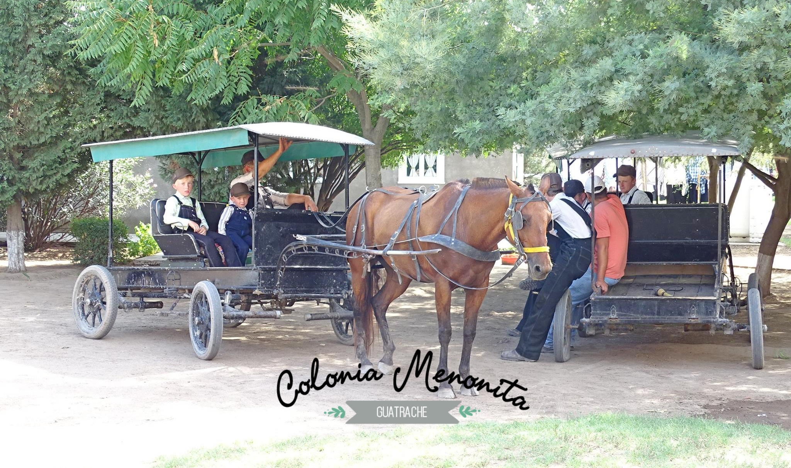
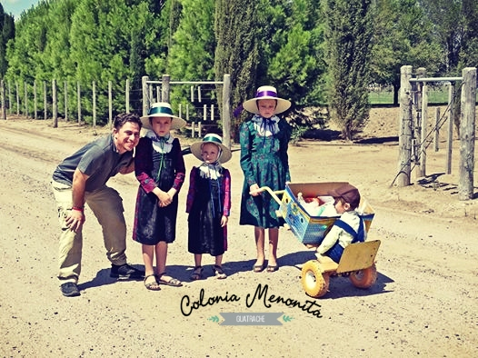
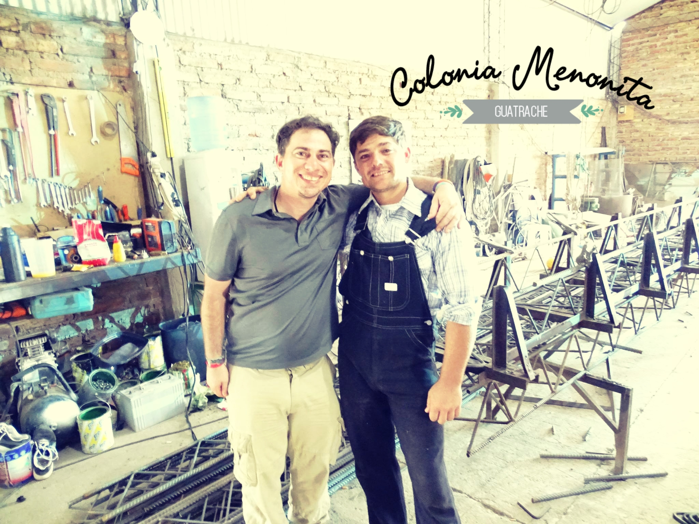
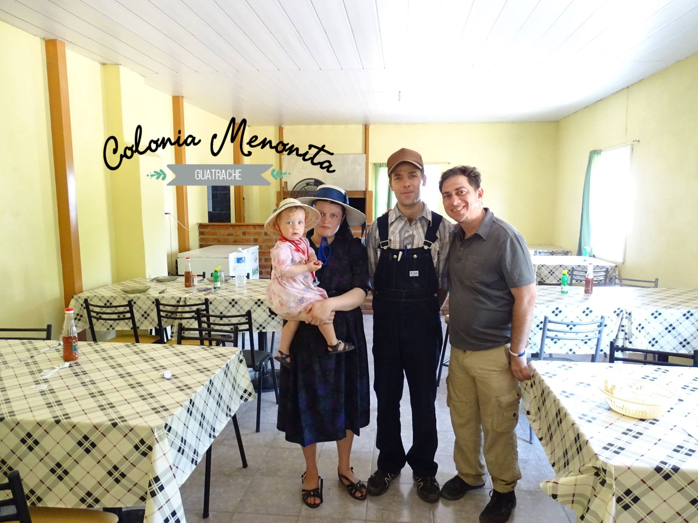
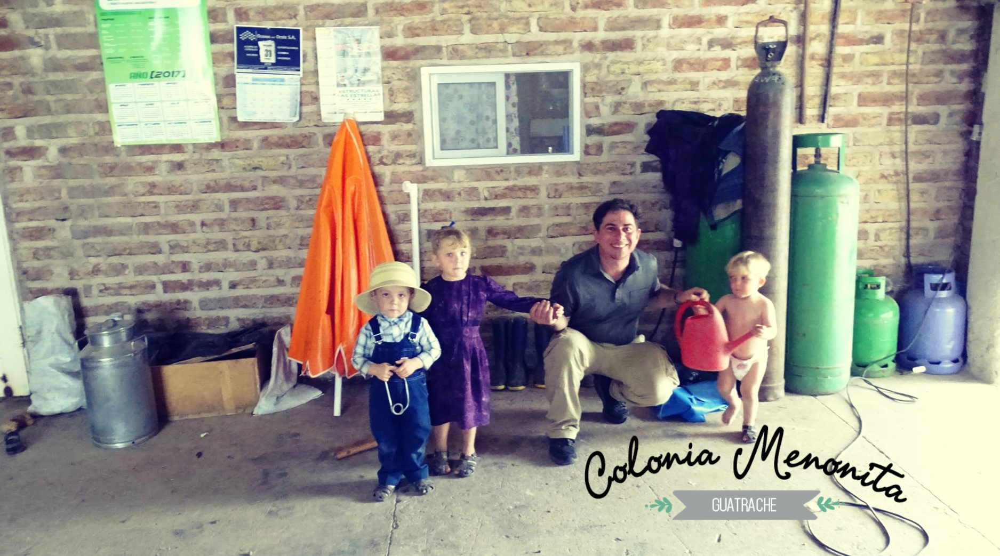

Colonia Menonita, una experiencia increíble!

Así arranca Howard su relato de su paso por la Colonia Nueva Esperanza en Febrero del pasado año. Hoy te traemos este relato de un viajero proveniente de Ontario, Canadá, quien visitó la Colonia y nos contó su experiencia.

Cerca de cuatro (4) años atrás, conocí a una pareja menonita en un parque en Buenos Aires y así es como aprendí acerca de dónde viven, en la pampa, Argentina.

Juan Ruvira era mi guía, quien conoce el lugar bastante bien y él es la persona que me trajo allí y me llevó el sábado, 25 de febrero de 2017.

Durante mi gira, pude visitar varias casas para ver cómo viven, Es increíble!

No tienen computadoras y no ven a televisión.

Sí, utilizan la electricidad, pero sobre todo para fines de trabajo, como para la agricultura.

La mayoría de los hombres usan monos y las mujeres llevan vestidos muy hermosos con flores por todas partes.

También tengo que ver talleres donde hacen varias cosas como muebles y queso.

Incluso tuve que ordeñar una vaca que para mí no era fácil, pero definitivamente fue un desafío por primera vez!

Te diré algo... Cuando yo estaba creciendo en casa en Toronto, ontario Canadá de vuelta en los años 1980 mis padres me llevaron a kitchener / Waterloo, ontario Canadá y ahí es donde vi a los menonitas por el mismo La primera vez, pero en ese momento, yo era muy joven y realmente no los entiendo.

Sin embargo, esta vez, fui capaz de conseguir una muy buena vista de pájaro de exactamente cómo viven y fue simplemente increíble!

También vi a muchos de ellos conduciendo el caballo y buggies a lo largo de las carreteras por sus granjas.

Quiero dar las gracias personalmente a juan ruvira en guatraché, la pampa argentina por llevarme allí.

Sinceramente tuyo,

Howard Paul Shore
Visitor
Executive Writer For Google And Tripadvisor Websites

Video

Fotografías

Relato original en Inglés
