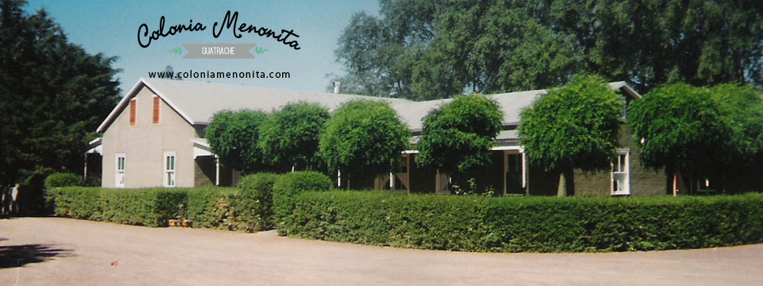

Dueños de una particular forma de vida y de trabajar la tierra, alejados de las comodidades del mundo contemporáneo, los Menonitas, seguidores de Simons Menno conservan sus costumbres y tradiciones holandesas y alemanas. Llevan una vida sencilla, alejada de los más elementales signos de la modernidad. Sus principales actividades son: tambo, quesería, carpintería, metalúrgica, comercio de ramos generales, confección de prendas de vestir, elaboración de conservas, construcción de carruajes, cría de animales de corral y cultivos propios de la huerta. La Iglesia es el punto de reunión, donde profesan su religión. Los domingos están reservados para el descanso y las visitas dentro de la comunidad.

## Colonia La Nueva Esperanza

Llegaron a la Argentina en 1985 procedentes de México, Bolivia y Paraguay, huyendo de los desmanes sociales, robos, cuatrerismo, y otras calamidades. Se establecieron de una colonia de 10.000 hectareas conocida como "Nueva Esperanza" a 40 Km. de Guatraché. Los campos que componen la colonia, todos con tranqueras flanqueadas por pinos y cipreses, y casas de adobes o de ladrillos, pintadas de celeste, negro o amarillo ocre. Al frente de cada vivienda, prolijanmente cuidados jardines. Flores y buenas plantaciones.

Pese a los siglos conservaron sus costumbres, son agricultores, hablan un dialecto mezcla de holandés y alemán y sus hijos reciben la misma educación que sus tatarabuelos.
