En la provincia de La Pampa, cerca de Guatraché, existe la **Colonia Nueva Esperanza**, que un grupo de **Menonitas** llegados desde Bolivia y México fundaron en 1985.

Llegaba desde Santa Rosa, la capital provincial. Cuando estaba acariciando los 200 kilómetros en el odómetro de mi camioneta (la mitad por pistas de tierra), vi a lo lejos de estas desiertas llanuras una gran fila de árboles que me confirmaban la presencia de vida humana. Hacia allá me dirigí.

Los Menonitas compraron **10.000 hectáreas** en estas desiertas tierras, y las dividieron en 10 colonias diferentes que van numeradas del 1 al 10. Cada una de esas colonias a su vez esta sub dividida en diferentes parcelas, cuyo tamaño corresponde a la cantidad de dinero que puso cada familia antes de largarse a cumplir sus sueños por estas alejadas pampas.

Lo primero que vi cuando accedí por la Colonia #3 fue esta imagen, y cuando el Menonita en el *Buggy* llego hacia donde yo estaba, lo saludé. Dos veces, para asegurarme, pero ninguno de los dos saludos me fue devuelto. De inmediato pude comprender a esta gente que hasta aquí llego buscando otro modo de vida, y llegan otros (unos pocos) a sacarle fotos como si fuesen "cosas raras".

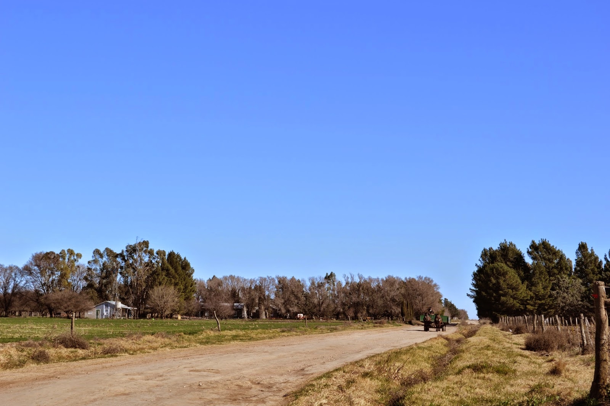

Por este motivo guarde discreción al máximo en todo momento a modo de respetar el modo de vida de las mas de **1.500 personas** bautizadas que viven en Colonia Nueva Esperanza. Aproximadamente el 1% del total mundial de Menonitas.

Las colonias están unidas y organizadas mediante 9 calles, a cuya vera están las casas. En cada una de estas casas se encuentran los carros en donde las familias Menonitas ponen su producción láctea diaria. El tambo, o **negocio de la leche**, es fundamental para la economía de los Menonitas aquí en La Pampa, tal como lo es en otros lugares del mundo en donde fueron aceptados.

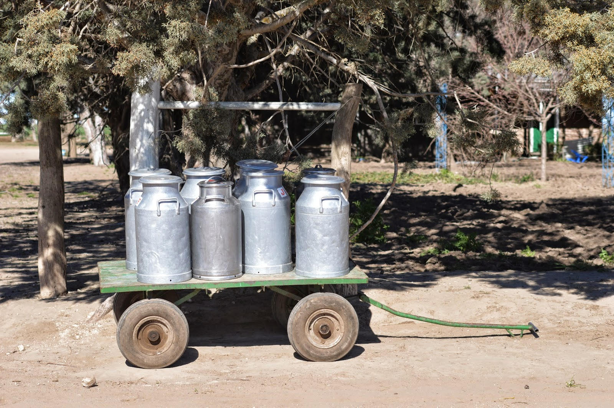

A estos carros con leche los pasan a buscar con estos carromatos, o *Buggies*, y el tipo sin bajarse y muy cancheramente levanta desde arriba la producción comunal.
Toda la familia participa en este gran negocio lechero, incluso los hombres, quienes prestan su ayuda en el primer ordeñe mañanero antes de ir a sus respectivos trabajos dentro de las colonias.

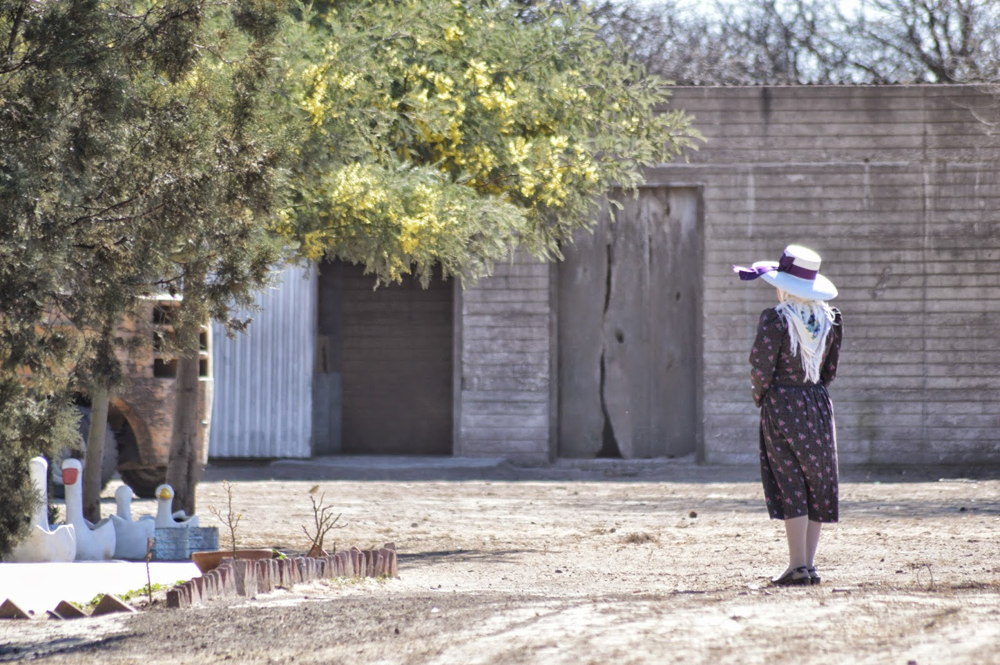

Pero no solo de leche vive el Menonita, para quien no hay nada mas importante que el trabajo, virtud que imponen a sus hijos desde tierna edad.
En las colonias, además del tambo, hay otras actividades productivas. Los Menonitas han montado **fábricas metalúrgicas** en donde construyen silos y comederos para animales que son muy apreciados por los productores rurales de la zona. Solo para el trabajo les es permitido el uso de la electricidad, lujo que ninguno de los Menonitas se permite en su casa. En las colonias no hay televisión. No escuchan mas música que la de los domingos de iglesia, ni han navegado por internet jamás.
En las colonias también hay una **fábrica de zapatos** de cuero y al menos otras tres en donde hacen **quesos** que salen a vender al exterior. Los Menonitas trabajan muy bien la madera y hacen sólidos muebles de calden que se venden en toda la provincia.

Siguiendo por los caminos de las colonias, en parte de lo que antiguamente era una porción de Estancia Remecó, se ven muestras de cuan **austeros** pueden ser los Menonitas, que llevan sus creencias al límite usando sus tractores con **ruedas de cemento**, o metálicas para que no se gasten, y según se cuenta por acá, "para que los mas jóvenes no puedan escaparse a la ciudad". Lo dicen con tanta seriedad que no me cabe duda que eso sea cierto.

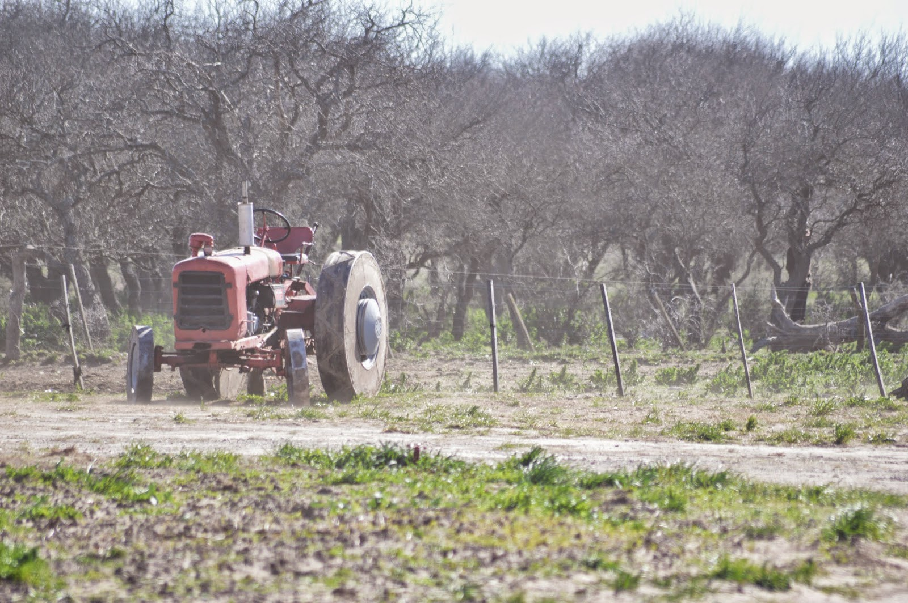

Lo notable es que se pasan todo el día arriba de estos viejos tractores, y labran la tierra de la misma forma en que se hacía varios siglos atrás.
Los Menonitas permanecen totalmente indiferentes a los adelantos tecnológicos que tanto mas fácil y rentable podría hacer sus trabajos. Desde afuera da la sensación de que es un pueblo que gusta sufrir, con tanta renuncia y aislamiento al que se someten.

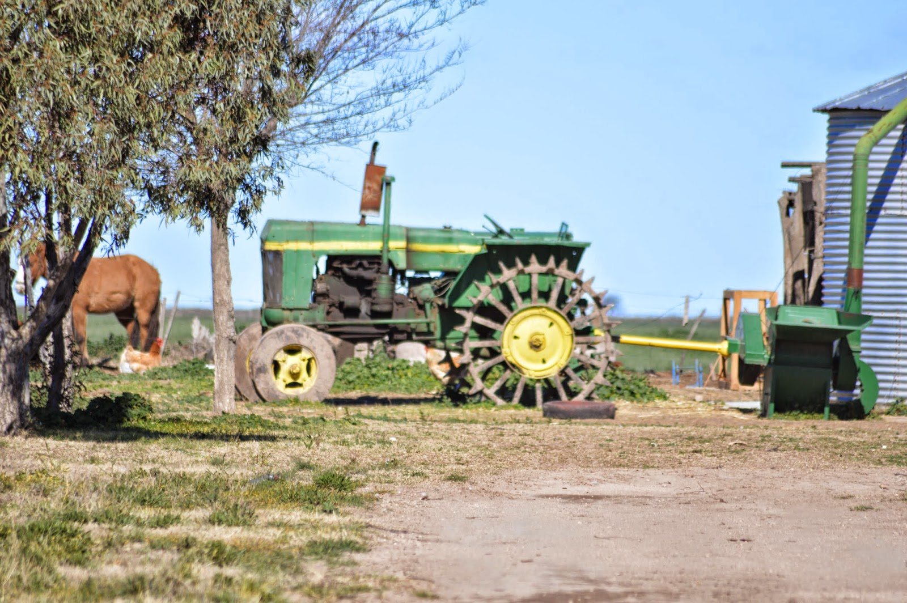

Pese a sus métodos rudimentarios, han convertido en pocos años un páramo como es este, en un **pueblo muy productivo**. Con el paso de los años, cuando estén mas asentados, y hayan crecido esos muchos cipreses, Colonia Nueva Esperanza va a a ser un lugar bonito, y una suerte de oasis en estas infinitas y desiertas llanuras castigadas por el incesante viento patagonico.

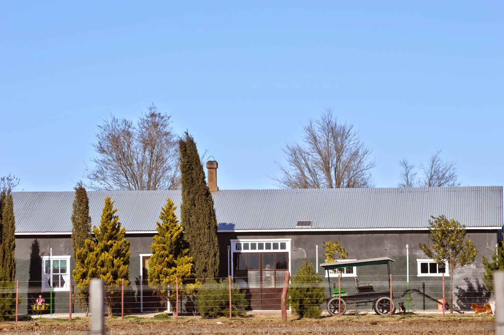

La vida en las colonias es muy cerrada, y según me compete no hay miembros ajenos a la comunidad viviendo entre estas familias**anabaptistas** seguidoras de **Menno Simons ,**originarias de Holanda y Alemania.

Las **mujeres**, además de ordeñar dos veces por día a sus vacas, y de sus quehaceres domésticos, confeccionan las prendas para el resto de su familia, e incluso algunas de mas para vender a propios y ajenos. Los hombres usan siempre un overol de tela de jean, y su gorro tipo cap. Las mujeres usan vestidos plenos o floreados, pero nunca estridentes. Como los hombres llevan siempre la cabeza tapada, y se identifica su condición civil por un pañuelo blanco en el caso de las **solteras**, o uno negro en el caso de las **casadas**.
Con grasa de chancho, aceite y un poco de cloro, las mujeres también se encargan de producir el jabón necesario para bañarse y lavar la ropa.
Los mas chicos dan una mano en los huertos que tienen a los costados de sus casas.

Cuando contraen **matrimonio** lo hacen siempre con otro miembro de la comunidad. Llegado el día, las familias de los enamorados se juntan un sábado para fortalecer sus vínculos. La mujer llevará en esta ocasión una prenda color camello, que ocho días mas tarde cambiará por una de color negro para casarse por iglesia al domingo siguiente.
Los novios se han mantenido sexualmente puros durante toda su vida premarital, y por lo general no tienen mucho tiempo para conocerse. Una vez establecida la unión amorosa no habrá lugar para el divorcio, ya que no les está permitido.
Es de imaginar que con tan poco para distraerse, los recién casados pasan su tiempo libre procreando, por lo que el crecimiento demográfico en las colonias suele ser muy rápido, y a la larga obliga a los Menonitas a buscar mayores extensiones de tierras para su comunidad, ya que cada uno de esos hijos heredará una porción de tierra para la subsistencia de su propia familia.

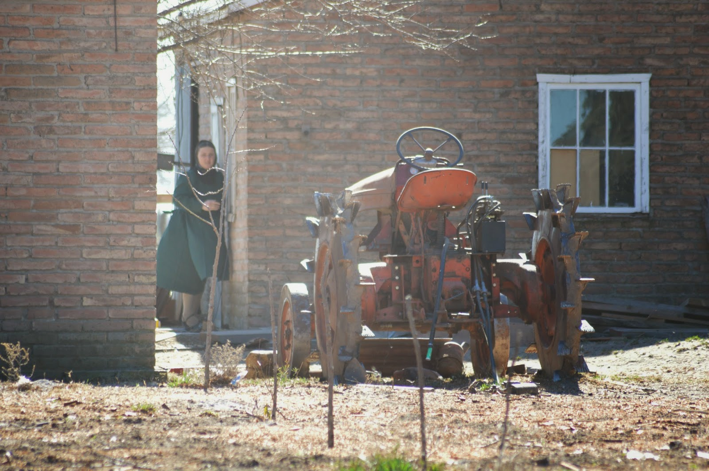

Ya habiendo salido de la Colonia #3 divisé el primer grupo de chicos que en forma inmediata se mostraron abiertos y amigables, aunque tímidos, ya que se mantuvieron a la distancia.

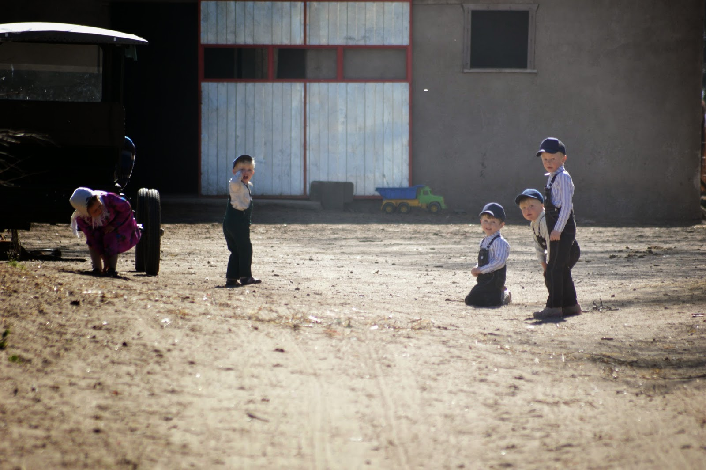

Los pequeños se tomaron de las manos, y dando una imagen de paz y sencillez difícil de ver en estos días, me regalaron esta serie de fotos.

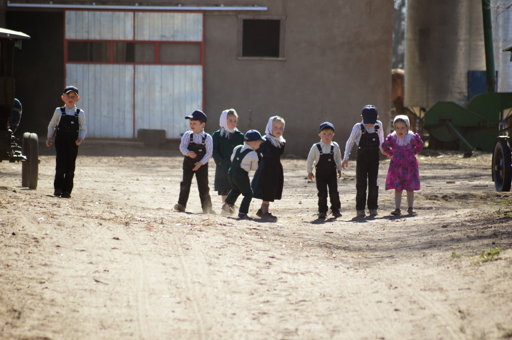

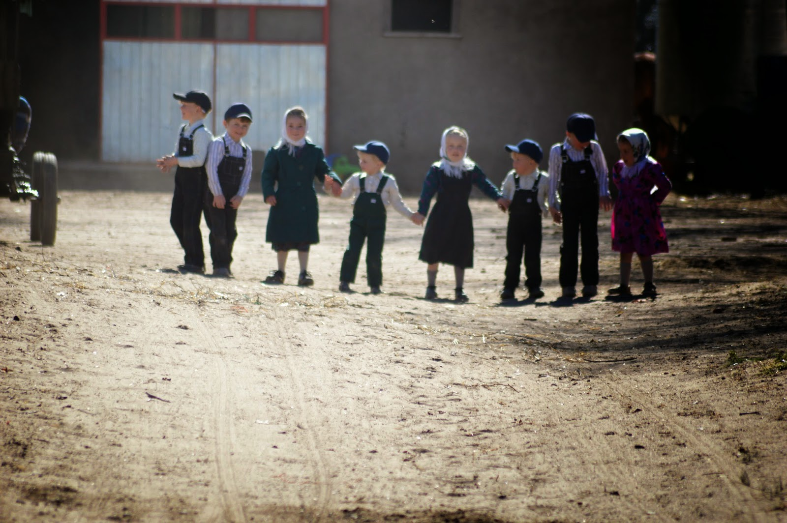

Cada una de las colonias tiene su **propia escuela** en donde los niños Menonitas asisten a clases en doble turno, pero solo hasta los doce años (trece en el caso de los hombres).
Pese a múltiples peleas con el Gobierno de La Pampa, los Menonitas no aceptan que sus hijos vayan a las escuelas públicas. Prefieren educarlos a su manera siguiendo los viejos métodos, e impartiendo las clases en **bajo alemán (Platdeutsch)**.
Siempre fue el idioma (dialecto) la principal barrera entre los Menonitas y el resto del mundo. Aquí en Argentina, los Menonitas han logrado mantenerse afuera de las leyes del país (tienen las propias), pero se han comprometido a enseñar el castellano a sus hijos.

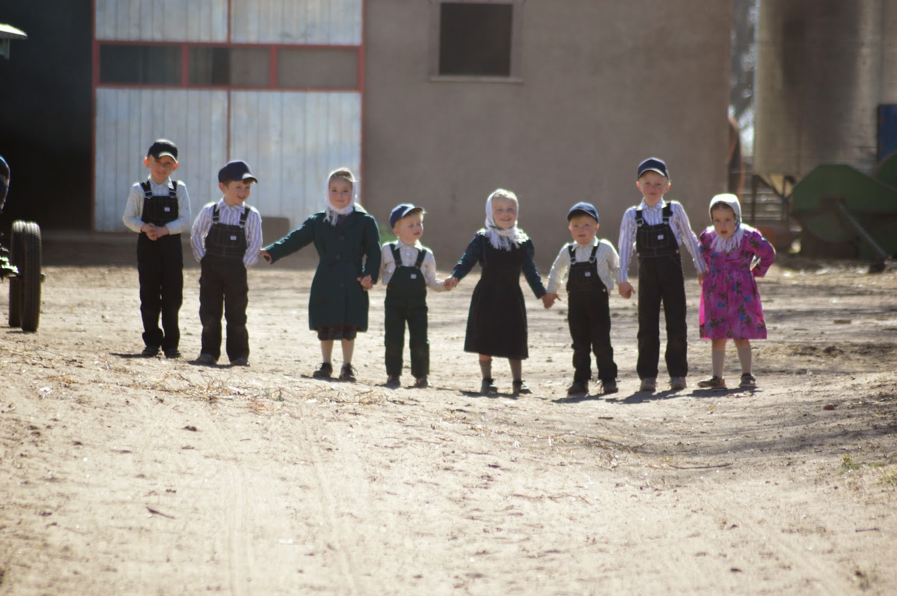

Nos saludamos a la distancia y proseguí en mi afán de pasar por todos los rincones de la colonia.

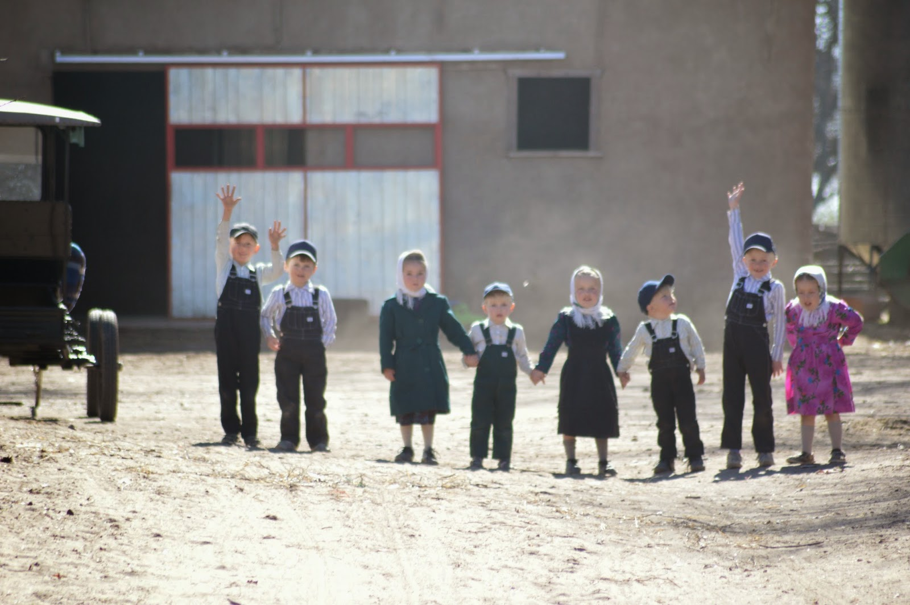

Se ven muchos aparatos reciclados con metales que probablemente provengan de los campos petroleros de la Patagonia.
Los hijos ven desde temprana edad la importancia del trabajo y permanecen toda la jornada junto a sus padres o hermanos, pese a la rigurosidad extrema del clima, de veranos largos y duros inviernos fríos de vientos inacabables.
Para muchos los Menonitas no son mas que una mera **organización sectaria**, y los métodos que usan para mantener y retener a los jóvenes han sido siempre cuestionados.

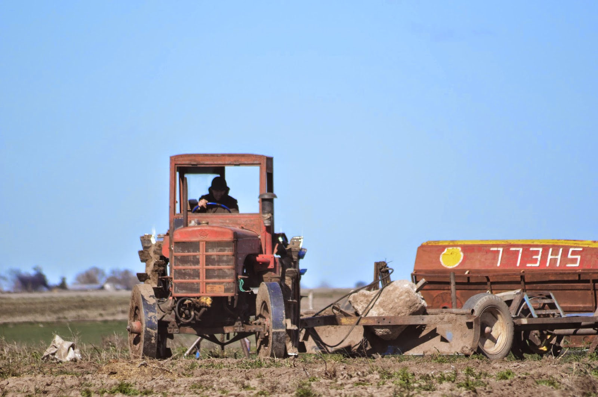

Entre tanta tierra trabajada, tanto tarro de leche, se observa que cada que cada casa, además de tener sus cortinas dobladas exactamente igual al resto, tiene su buggy (como les gusta llamarlo a ellos). El transporte Menonita por excelencia, cumple las mismas funciones que los autos, cuyo uso tienen prohibido.

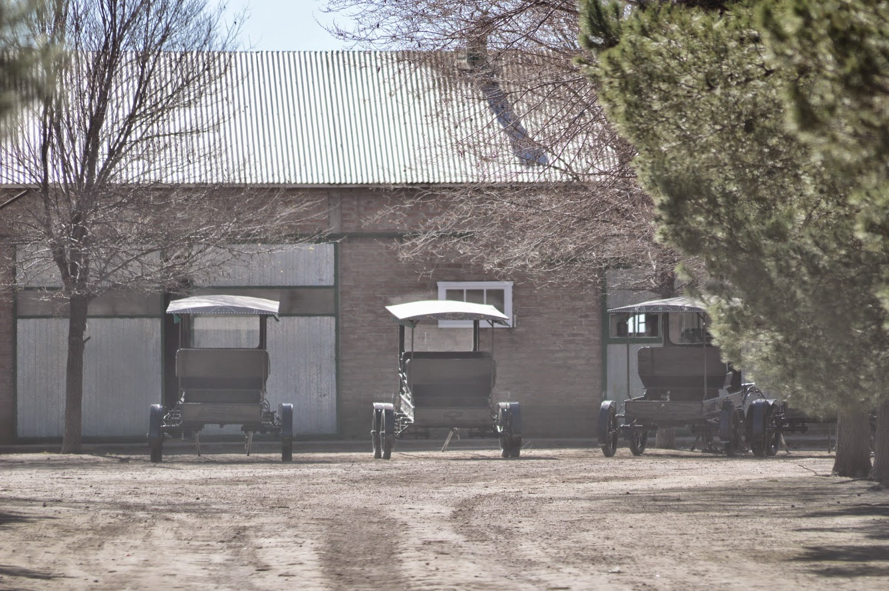

Las iglesias apenas pueden reconocerse desde afuera, y carecen de adornos y decoración. Siempre cuentan con dos puertas de entrada, y los bancos están puestos en forma transversal, y no longitudinal como suelen estar en las demás iglesias del mundo. Una vez dentro, hombres y mujeres mayores de 12 años no podrán mirarse los unos a los otros.
La **vida religiosa** juega un papel central entre los colonos Menonitas.
Cuando comprendan los Santos Evangelios y los pecados, llegando con 18 años a su vida adulta, los Menonitas eligen por Motus propio el bautismo, momento en el que son considerados y contados como un miembro mas de la comunidad.

Como los Menonitas creen que todos son iguales ante los ojos de Dios, no tienen mayor **rito funerario** que enterrar a sus muertos en el cementerio común sin identificación alguna, ya que nunca volverán a visitar a su fallecido. Solo velan al muerto durante 4 días a modo de darle tiempo a sus familiares de acercarse a la colonia para despedirse por única vez.

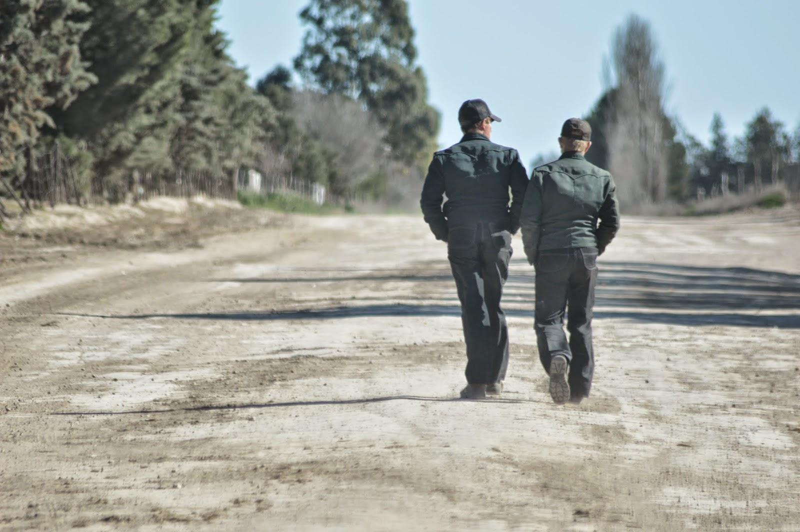

Los Menonitas son gente orgullosa de sus **firmes creencias** y forma de vida. Es un pueblo que (casi) no conoce de la mentira y otros malos hábitos.
Nunca adoptaron la nacionalidad de los países que los reciben, y siempre permanecen ajenos a la política y los conflictos locales. Ellos siempre se sienten extranjeros. No hay nacionalismo válido entre estas gentes, y siempre consiguen ventajas del gobierno, razón por la cual son odiados en algunos de los lugares en donde viven. Esta falta de integración del pueblo menonita hacia el lugar que los acoge los hizo pasear por medio mundo.

En sus casas hablan el Bajo Alemán, y es probable que solo el hombre domine la lengua extranjera del país en donde viven, y solo tiene propósitos comerciales.

Pocas costumbres parecen haber cambiado en estos mas de 400 años que pasaron desde que se separaron de la Iglesia Católica. Visitar una colonia Menonita es como un viaje a una isla del pasado.
